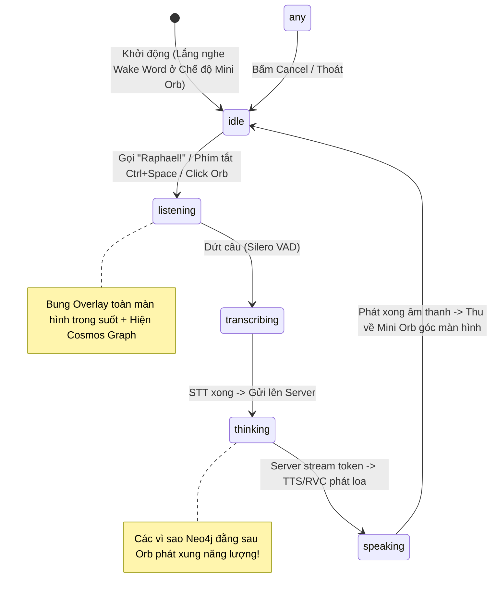

# 📜 HỢP ĐỒNG GIAO TIẾP FRONTEND (FRONTEND CONTRACT)
> **Dành cho Agent chuyên trách UI/UX**: Tài liệu này đặc tả toàn bộ kiến trúc giao diện thị giác **Raphael (Tensura)** và giao thức kết nối WebSocket với **Core Audio Pipeline** (Backend chạy ngầm trên RTX 2050).
> Hãy bám sát tài liệu này để hiện thực hóa giao diện ma pháp đẳng cấp cao: **Quả cầu Raphael Orb**, **Vũ trụ tri thức Neo4j Cosmos Graph**, **Overlay trong suốt**, **Thu nhỏ góc màn hình**, và **Gemini Sidedeck Panel**.

---

## 1. Kiến Trúc 3 Chế Độ Hiển Thị Thị Giác (Visual Modes)

Frontend cần hiện thực 3 chế độ chuyển cảnh (Morphing Transitions) mượt mà cho Quả cầu năng lượng Raphael (The Runic Orb):

```text
┌─────────────────────────────────────────────────────────────────────────────────┐
│ [Chế độ 1: Fullscreen Transparent Overlay]                                      │
│                                                                                 │
│         ★          ·        ✦  (Neo4j Cosmos Graph)     ·             ★         │
│               ·         ╱                                                       │
│          ✦  ───────── ◯ (Raphael Orb Trung Tâm) ───────── ✦          ·          │
│                       │      [Runic Ring + FFT Glow]     │                      │
│         ·             ╲                                  │             ✦        │
│                    ·       ★                            ★                       │
│                                                                                 │
└─────────────────────────────────────────────────────────────────────────────────┘
                                   │
               ┌───────────────────┴───────────────────┐
               ▼                                       ▼
┌───────────────────────────────────────┐  ┌──────────────────────────────────────┐
│ [Chế độ 2: Docked Mini Orb]           │  │ [Chế độ 3: Gemini Sidedeck Panel]    │
│ Màn hình làm việc bình thường...      │  │ Desktop...   │ ◯ (Orb trên Header)   │
│                                       │  │              │───────────────────────│
│                                       │  │              │ 💬 Lịch sử hội thoại  │
│                                       │  │              │ ✦ Chòm sao tri thức   │
│                 [ ◯ Mini Orb ở Góc ]  │  │              │ ⌨️ Khung nhập chat   │
└───────────────────────────────────────┘  └──────────────────────────────────────┘
```

### 1.1. Chế độ 1: Overlay Toàn Màn Hình Trong Suốt (`fullscreen_transparent_overlay`)
* **Cách kích hoạt**: Khi gọi Wake Word (*"Raphael!"*, *"Hey Jarvis"*), bấm phím tắt `Ctrl + Space`, hoặc nhấp vào Mini Orb.
* **Đặc điểm giao diện**:
  * Nền: Trong suốt hoàn toàn hoặc có lớp mờ viền vignette (`backdrop-blur` nhẹ), người dùng vẫn nhìn thấy màn hình Windows/ứng dụng làm việc bên dưới.
  * Trung tâm: **Quả cầu ma pháp Raphael (The Central Orb)** với các vòng tròn ma thuật Runic xoay đồng tâm, phát sáng rực rỡ và co giãn biên độ theo dữ liệu âm thanh thời gian thực (`audio_levels`).
  * **Phía sau Orb chính**: **Vũ trụ Tri thức Neo4j (Cosmos Knowledge Graph)**. Toàn bộ các node và liên kết của Neo4j được render thành mạng lưới các vì sao (Stars) và dải ngân hà huyền ảo (sử dụng HTML5 Canvas 2D, Three.js hoặc React-Force-Graph).
  * **Hiệu ứng Truy vấn Thời gian thực (Real-time Query Highlight)**: Mỗi khi người dùng hỏi hoặc LLM suy luận, các ngôi sao tri thức liên quan sẽ phát xung năng lượng, đường liên kết phát sáng chạy dọc chòm sao đằng sau quả cầu Orb!

### 1.2. Chế độ 2: Thu Nhỏ Xuống Góc Màn Hình (`docked_mini_orb`)
* **Cách kích hoạt**: Khi trợ lý trả lời xong câu hỏi, hoặc khi người dùng bấm nút thu nhỏ / nhấp ra ngoài.
* **Đặc điểm giao diện**:
  * Toàn bộ vũ trụ sao mờ dần và ẩn đi (Fade-out).
  * Quả cầu Orb chính thu nhỏ kích thước (Morph/Scale) và bay mượt mà xuống góc dưới bên phải màn hình (Bottom-Right Floating Widget).
  * Ở góc màn hình, Orb tiếp tục xoay chậm và thở nhẹ (Pulsing breath), duy trì việc lắng nghe từ khóa Wake Word ngầm.

### 1.3. Chế độ 3: Bảng Điều Khiển Trượt Gemini Sidedeck (`sidedeck_chat_panel`)
* **Cách kích hoạt**: Khi người dùng muốn xem lại nhật ký hội thoại, tinh chỉnh cấu hình, hoặc gõ văn bản chi tiết.
* **Đặc điểm giao diện**:
  * Một thanh Panel trượt ra êm ái từ cạnh phải màn hình (rộng khoảng 380px - 450px), tương tự như giao diện Gemini Side Panel.
  * **Quả cầu Orb Raphael di chuyển mượt mà** tới tọa độ nằm ở góc trên hoặc ngay phía trên thanh Header của Sidedeck Panel như một linh vật trợ lý sống động.
  * Nội dung bên trong Sidedeck:
    * Luồng tin nhắn chat với hiệu ứng gõ chữ (Typewriter effect).
    * Bảng tóm tắt các thực thể tri thức Neo4j vừa được truy vấn.
    * Nút chuyển chế độ (Voice / Text only), nút thử kết nối Tailscale và bật/tắt Wake Word.

---

## 2. Thông Tin Kết Nối WebSocket

- **Giao thức**: WebSocket (`ws://`)
- **Địa chỉ mặc định**: `ws://127.0.0.1:8765`
- **Định dạng dữ liệu**: `JSON` (UTF-8)
- **Tái kết nối tự động**: Khuyến nghị Client thử kết nối lại sau mỗi 2 giây nếu mất kết nối.

---

## 3. Vòng Đời Trạng Thái (State Machine)



Các giá trị trạng thái (`status`):
- `"idle"`: Đang nghỉ ngơi / chờ lệnh (Orb xoay chậm màu xanh ngọc lam).
- `"listening"`: Đang thu âm từ Micro (Orb bừng sáng rực rỡ, phản ứng sóng âm theo giọng người).
- `"transcribing"`: Chuyển giọng nói sang văn bản qua Faster-Whisper.
- `"thinking"`: Đang gửi câu hỏi lên Server Tailscale (Các vì sao Neo4j chớp sáng dẫn truyền).
- `"speaking"`: Đang phát giọng Raphael ra loa ngoài và stream chữ.
- `"error"`: Mất kết nối hoặc sự cố hệ thống.

---

## 4. Bản Tin từ Backend gửi tới Frontend (Pipeline -> UI)

### 4.1. Đánh thức bằng Từ khóa (`wake_word_detected`)
Gửi ngay khi người dùng cất tiếng gọi tên trợ lý (ví dụ: *"Raphael"*, *"Hey Jarvis"*).
```json
{
  "type": "wake_word_detected",
  "data": {
    "keyword": "raphael",
    "timestamp": 1726500000.123
  }
}
```
> **Hành vi UI**: Ngay lập tức bung Chế độ 1 (Overlay toàn màn hình trong suốt), quả cầu Orb phát sáng chớp lóe và sẵn sàng thu âm.

---

### 4.2. Dữ liệu Toàn bộ Đồ thị Tri thức Neo4j (`graph_data`)
Được gửi ngay khi Frontend vừa kết nối WebSocket, hoặc khi người dùng yêu cầu làm mới đồ thị.
```json
{
  "type": "graph_data",
  "data": {
    "is_live_db": true,
    "nodes": [
      { "id": "raphael", "name": "Đại Hiền Triết / Raphael", "group": "CoreSkill", "color": "#00f0ff", "val": 22 },
      { "id": "rimuru", "name": "Rimuru Tempest", "group": "Character", "color": "#38bdf8", "val": 26 },
      { "id": "veldora", "name": "Veldora Tempest", "group": "Dragon", "color": "#facc15", "val": 20 }
    ],
    "links": [
      { "source": "rimuru", "target": "raphael", "type": "POSSESSES" },
      { "source": "rimuru", "target": "veldora", "type": "SWORN_FRIEND" }
    ]
  }
}
```
> **Gợi ý cho UI**: Dùng dữ liệu này để vẽ mạng lưới các ngôi sao vũ trụ nằm ở lớp nền phía sau Quả cầu Orb Raphael.

---

### 4.3. Highlight Chùm sao Tri thức Theo Câu Hỏi (`graph_query_highlight`)
Được gửi ngay khi người dùng vừa đặt câu hỏi (ở trạng thái `thinking`), chỉ định các node và link nào trong vũ trụ đang được AI kích hoạt.
```json
{
  "type": "graph_query_highlight",
  "data": {
    "query": "Raphael hãy phân tích lượng ma tố của Veldora",
    "highlighted_nodes": ["raphael", "veldora", "magicules"],
    "highlighted_links": [
      { "source": "rimuru", "target": "raphael", "type": "POSSESSES" },
      { "source": "rimuru", "target": "veldora", "type": "SWORN_FRIEND" }
    ],
    "timestamp": 1726500005.456
  }
}
```
> **Gợi ý cho UI**: Khi nhận sự kiện này, các ngôi sao có ID trong `highlighted_nodes` sẽ sáng rực lên gấp đôi, và đường liên kết giữa chúng sẽ bắn các xung hạt năng lượng phát sáng chạy qua lại đằng sau Orb!

---

### 4.4. Thay đổi Trạng thái (`state_change`)
```json
{
  "type": "state_change",
  "data": {
    "status": "listening",
    "timestamp": 1726500000.123
  }
}
```

---

### 4.5. Dữ liệu Sóng âm Thời gian thực (`audio_levels`)
Được gửi liên tục (30 - 60 FPS) khi đang thu mic hoặc khi Raphael đang nói.
```json
{
  "type": "audio_levels",
  "data": {
    "source": "mic",               // "mic" hoặc "speaker"
    "rms": 0.45,                   // Biên độ âm lượng (0.0 đến 1.0)
    "peak": 0.82,
    "spectrum": [                  // Phổ tần số 32 dải (0.0 đến 1.0)
      0.15, 0.32, 0.65, 0.92, 0.78, 0.50, 0.35, 0.22,
      0.18, 0.12, 0.08, 0.05, 0.03, 0.02, 0.01, 0.00
    ]
  }
}
```
> **Gợi ý cho UI**: Dùng `rms` để điều khiển độ to nhỏ của Quả cầu Orb, dùng `spectrum` để làm các vòng hào quang Runic xung quanh Orb rung động theo âm điệu.

---

### 4.6. Văn bản Người dùng nói (`user_transcript`)
```json
{
  "type": "user_transcript",
  "data": {
    "text": "Báo cáo tình hình tiêu hao ma lực.",
    "is_final": true
  }
}
```

---

### 4.7. Dòng chữ Stream từ Trợ lý (`assistant_stream`)
```json
{
  "type": "assistant_stream",
  "data": {
    "delta": "Báo cáo: ",
    "full_text": "Báo cáo: Mức độ tiêu hao ma lực đang ở ngưỡng 12%."
  }
}
```

---

### 4.8. Kết thúc phản hồi (`assistant_done`)
```json
{
  "type": "assistant_done",
  "data": {
    "full_text": "Báo cáo: Mức độ tiêu hao ma lực đang ở ngưỡng 12%, hoàn toàn an toàn.",
    "duration_ms": 2800
  }
}
```

---

### 4.9. Cảnh báo / Lỗi (`error`)
```json
{
  "type": "error",
  "data": {
    "code": "SERVER_UNREACHABLE",
    "message": "Không thể kết nối đến Máy chủ Linh hồn (Tailscale Offline)."
  }
}
```

---

## 5. Bản Tin từ Frontend gửi về Backend (UI -> Pipeline)

### 5.1. Bắt đầu / Dừng lắng nghe (Push-to-Talk)
```json
{ "action": "start_listen" }
{ "action": "stop_listen" }
```

### 5.2. Gửi câu hỏi bằng Chữ (Text Input)
```json
{
  "action": "send_text",
  "data": { "text": "Phân tích đồ thị liên kết của Veldora." }
}
```

### 5.3. Yêu cầu nạp lại Đồ thị Tri thức Neo4j (`get_graph_data`)
```json
{ "action": "get_graph_data" }
```

### 5.4. Tìm kiếm / Truy vấn đồ thị (`query_graph`)
```json
{
  "action": "query_graph",
  "data": { "query": "Rimuru" }
}
```

### 5.5. Bật / Tắt Lắng nghe Wake Word (`set_wake_word`)
```json
{
  "action": "set_wake_word",
  "data": { "enabled": true }
}
```

### 5.6. Chuyển đổi Chế độ Xuất (`set_output_mode`)
```json
{
  "action": "set_output_mode",
  "data": { "mode": "voice_and_text" } // "voice_and_text" | "text_only" | "voice_only"
}
```

### 5.7. Ngắt lời tức thì (`cancel`)
```json
{ "action": "cancel" }
```

### 5.8. Cập nhật Cấu hình (`update_config`)
```json
{
  "action": "update_config",
  "data": {
    "remote_server_url": "http://100.85.12.45:8000/api/chat",
    "hotkey": "ctrl+space",
    "wake_word_enabled": true,
    "rvc_enabled": true
  }
}
```

---

## 6. TypeScript Types Tham Khảo (Dành Cho Agent UI/UX)

```typescript
export type AssistantStatus = "idle" | "listening" | "transcribing" | "thinking" | "speaking" | "error";
export type UIVisualMode = "fullscreen_transparent" | "docked_mini" | "sidedeck";
export type OutputMode = "voice_and_text" | "text_only" | "voice_only";

export interface CosmosNode {
  id: string;
  name: string;
  group?: string;
  color?: string;
  val?: number; // Bán kính ngôi sao
  properties?: Record<string, any>;
}

export interface CosmosLink {
  source: string;
  target: string;
  type?: string;
  properties?: Record<string, any>;
}

export interface CosmosGraphData {
  is_live_db: boolean;
  nodes: CosmosNode[];
  links: CosmosLink[];
}

export interface GraphHighlightData {
  query: string;
  highlighted_nodes: string[];
  highlighted_links: Array<{ source: string; target: string; type?: string }>;
  timestamp: number;
}

export interface AudioLevelsData {
  source: "mic" | "speaker";
  rms: number;
  peak: number;
  spectrum: number[];
}

export interface PipelineMessage {
  type: 
    | "state_change" 
    | "wake_word_detected" 
    | "graph_data" 
    | "graph_query_highlight" 
    | "audio_levels" 
    | "user_transcript" 
    | "assistant_stream" 
    | "assistant_done" 
    | "error";
  data: any;
}
```
